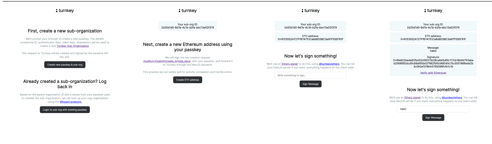

# Demo Ethers 🤝 Passkeys

> [!WARNING]
> **This demo is deprecated and no longer maintained. Please do not use it as a starting point.**
>
> It uses [`@turnkey/sdk-react`](https://www.npmjs.com/package/@turnkey/sdk-react) and
> [`@turnkey/sdk-browser`](https://www.npmjs.com/package/@turnkey/sdk-browser), which are deprecated in favor
> of [`@turnkey/react-wallet-kit`](https://www.npmjs.com/package/@turnkey/react-wallet-kit) — or
> [`@turnkey/core`](https://www.npmjs.com/package/@turnkey/core) if you aren't using React.
>
> **Use one of these instead:**
>
> | If you want | Use this |
> | --- | --- |
> | Passkey sign-up and login with a backend that creates sub-organizations | [`examples/authentication/with-passkeys`](https://github.com/tkhq/sdk/tree/main/examples/authentication/with-passkeys) |
> | ethers specifically | [`@turnkey/ethers`](https://github.com/tkhq/sdk/tree/main/packages/ethers) with [`examples/chain-integrations/with-ethers`](https://github.com/tkhq/sdk/tree/main/examples/chain-integrations/with-ethers) |
>
> See the [SDK repo](https://github.com/tkhq/sdk) and [docs](https://docs.turnkey.com).

This repo contains a sample application **for demonstration purposes only**, walking through how to create sub-organizations, create private keys, and sign with the [`@turnkey/ethers`](https://github.com/tkhq/sdk/tree/main/packages/ethers) signer, using passkeys. Please feel free to clone or fork this repo, or file an issue if there are improvements to be made! ❤️



The flow showcases 3 ways to make requests to Turnkey:

- the initial request to create a new [sub-organization](https://docs.turnkey.com/getting-started/sub-organizations) is authenticated in the NextJS backend with an API signature (using `API_PUBLIC_KEY`/`API_PRIVATE_KEY` from your `.env.local` file)
- the request to create a new ETH address is signed on the frontend with your passkey, but it's passed to the NextJS backend as a signed request (the body, stamp, and url are POSTed). This lets the backend submit this request on your behalf, and poll until the new "create private keys" activity completes. Once the activity completes it returns the new address to the frontend
- the request to sign a message is done 100% client-side via a Turnkey Ethers signer (see [@turnkey/ethers](https://github.com/tkhq/sdk/tree/main/packages/ethers)): it's signed with your passkey, and submitted from the browser to the Turnkey API directly.

If you want to see a Viem demo with API keys instead of passkeys, head to the example [`with-ethers`](https://github.com/tkhq/sdk/tree/main/examples/with-ethers). A demo using passkeys with Viem can be found [here](https://github.com/tkhq/demo-viem-passkeys). See our [SDK repo](https://github.com/tkhq/sdk) for additional packages and examples.

## Getting started

### 1/ Clone or fork this repo

Make sure you have `Node.js` installed locally; we recommend using Node v16+.

```bash
$ git clone https://github.com/tkhq/demo-ethers-passkeys.git
$ corepack enable  # Install `pnpm`
$ pnpm install # Install dependencies
$ pnpm run build  # Compile source code
```

### 2/ Setting up Turnkey

The first step is to set up your Turnkey organization and account. By following the [Quickstart](https://docs.turnkey.com/getting-started/quickstart) guide, you should have:

- A public/private API key pair for Turnkey
- An organization ID

Once you've gathered these values, add them to a new `.env.local` file. Notice that your API private key should be securely managed and **_never_** be committed to git.

```bash
$ cp .env.local.example .env.local
```

Now open `.env.local` and add the missing environment variables:

- `API_PUBLIC_KEY`
- `API_PRIVATE_KEY`
- `NEXT_PUBLIC_TURNKEY_API_BASE_URL`
- `NEXT_PUBLIC_ORGANIZATION_ID`

### 3/ Running the app

```bash
$ pnpm run dev
```

This command will start a NextJS app on localhost. If you navigate to http://localhost:3000 in your browser, you can follow the prompts to create a sub organization, create a private key for the newly created sub-organization, and sign a message using your passkey with a ethers custom account!

# Legal Disclaimer

THE SOFTWARE IS PROVIDED "AS IS", WITHOUT WARRANTY OF ANY KIND, EXPRESS OR IMPLIED, INCLUDING BUT NOT LIMITED TO THE WARRANTIES OF MERCHANTABILITY, FITNESS FOR A PARTICULAR PURPOSE AND NONINFRINGEMENT. IN NO EVENT SHALL TURNKEY BE LIABLE FOR ANY CLAIM, DAMAGES OR OTHER LIABILITY, WHETHER IN AN ACTION OF CONTRACT, TORT OR OTHERWISE, ARISING FROM, OUT OF OR IN CONNECTION WITH THE SOFTWARE OR THE USE OR OTHER DEALINGS IN THE SOFTWARE.
